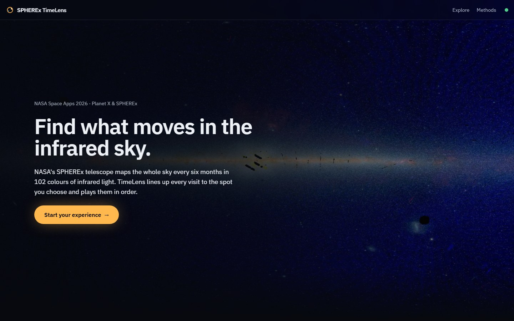
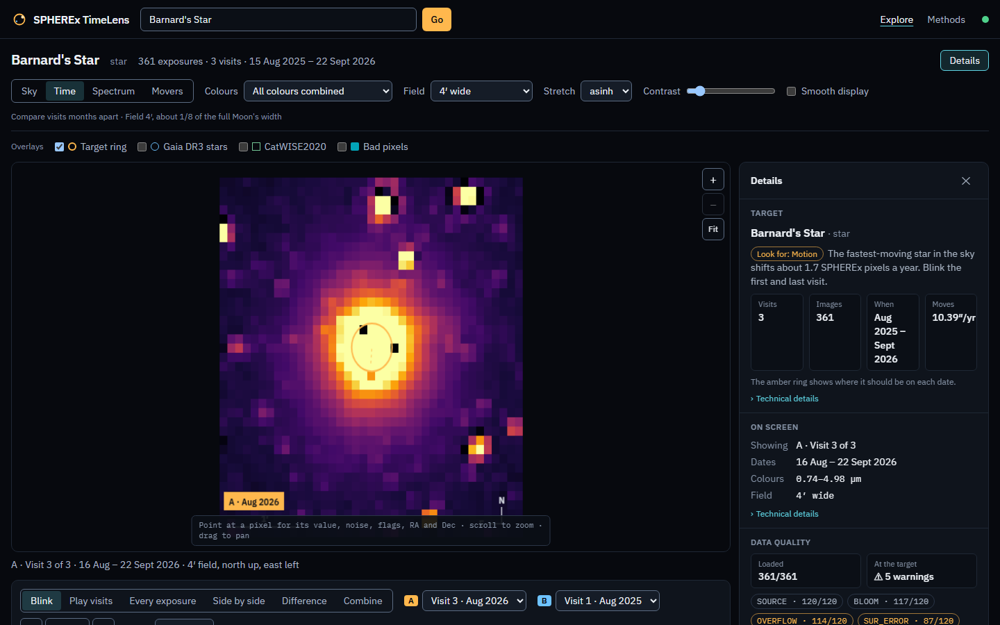
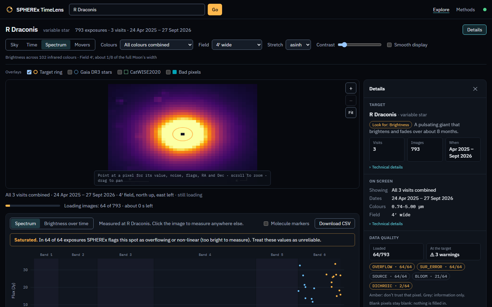
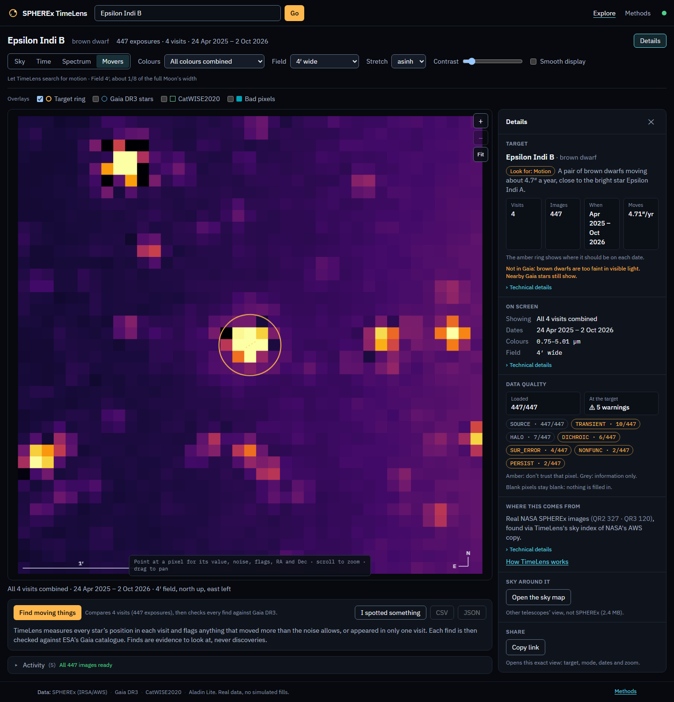
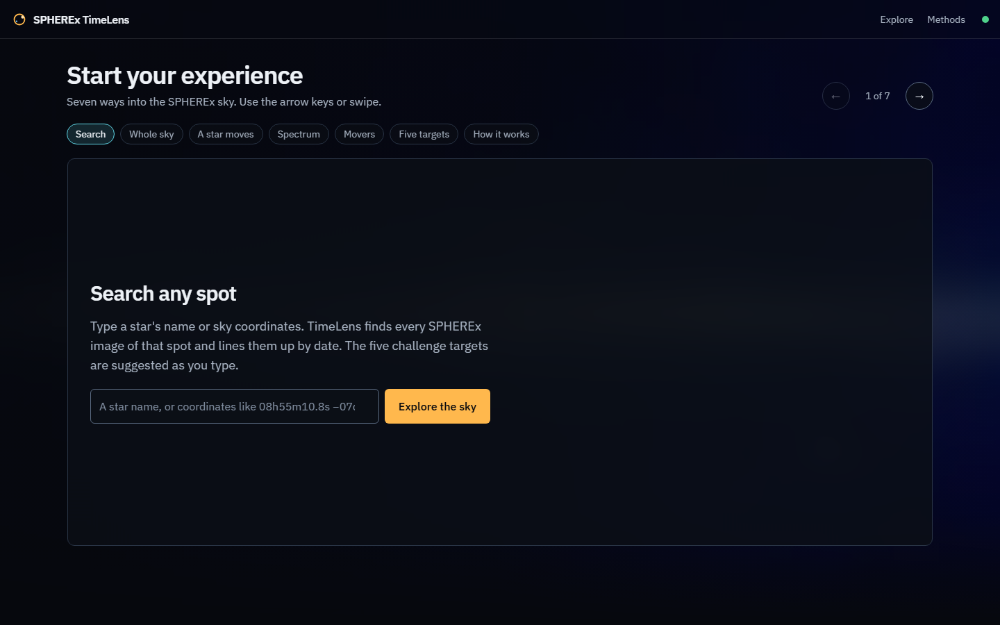
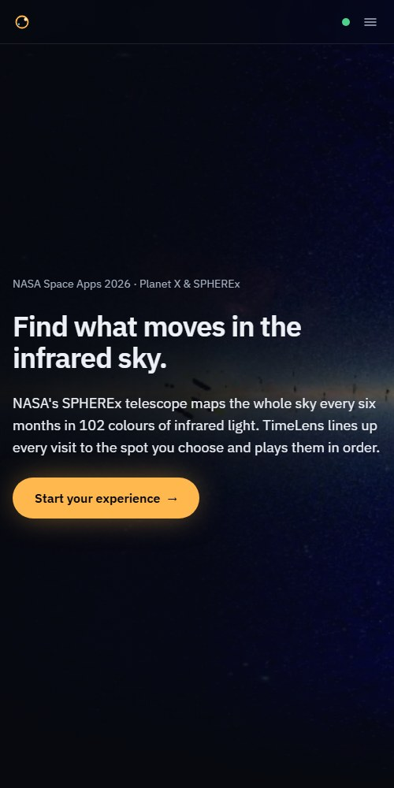

# SPHEREx TimeLens

**Find what moves in the infrared sky.** NASA's SPHEREx telescope maps the whole sky about every six months in
102 colours of infrared light. TimeLens finds every SPHEREx image of the spot you choose, lines them up, and lets
you compare the visits: blink them, play them in order, subtract one from another, read a spectrum, or let the
app search for things that moved.

Built for NASA Space Apps 2026 (Planet X & SPHEREx). Everything shown is real SPHEREx data from NASA/IPAC:
nothing is simulated, and pixels SPHEREx left blank stay blank.



## Screenshots

| | |
| --- | --- |
|  |  |
| **Time:** Barnard's Star, blinking visits a year apart. The amber ring marks where it should be. | **Spectrum:** R Draconis across the 102 colours, with flags warning where the star is too bright to measure. |
|  |  |
| **Movers:** Epsilon Indi B, a brown dwarf pair. Finds are checked against Gaia DR3. | **Start:** seven ways into the app, one slide at a time. |

<p align="center">
  
  <br><em>Home on a phone</em>
</p>

## What you can do

| Page | What it is |
| --- | --- |
| `/` Home | A full-screen hero over the SPHEREx all-sky map, with **Start your experience** |
| `/start` | Seven feature slides, each a link into the app: search, the whole-sky globe, a moving star, a spectrum, the mover hunt, the five challenge targets, and how it works |
| `/explore?q=…` | The workspace for one target (see below) |
| `/about` | Methods: where the data comes from, how images are lined up, and the limits |
| `/embed?q=…` | A compact view for embedding in other pages |

The **Explore** workspace has four modes:

- **Sky:** the deepest picture, every visit added together.
- **Time:** compare visits months apart. Views: blink, play, exposures, side by side, difference, and combine.
- **Spectrum:** brightness across the 102 infrared colours, with charts and a CSV download.
- **Movers:** TimeLens compares visits and lists what shifted, checked against Gaia, so you can review each
  candidate and export the list (CSV or JSON). Candidates are evidence to check, never discoveries.

Overlays (Gaia DR3 and CatWISE2020 stars, the expected-position ring, bad-pixel flags) and a **Details**
panel show where every number comes from. Links keep the full view (target, mode, visits, colours, zoom), so
you can share exactly what you see.

### The five challenge targets

| Target | What it is | Look for |
| --- | --- | --- |
| Barnard's Star | Red dwarf, the fastest-moving star in the sky | Motion |
| Epsilon Indi B | Brown dwarf pair | Motion |
| WISE 0855−0714 | The coldest known brown dwarf | Motion |
| RW Aurigae | Young variable star | Brightness |
| R Draconis | Pulsating red giant | Brightness |

Any other star name or sky coordinates also work.

## Running it locally

You need **Python 3.11+** and a recent **Node.js** (22 LTS works). No API keys are needed. The commands below
use Windows paths (`.venv/Scripts/…`); on macOS or Linux use `.venv/bin/…`.

### 1. Backend (FastAPI, port 8000)

```bash
cd backend
python -m venv .venv
.venv/Scripts/python -m pip install -r requirements-dev.txt
.venv/Scripts/python -m uvicorn app.main:app --reload --port 8000
```

The interactive API docs are at http://localhost:8000/api/docs.

### 2. Frontend (React + Vite, port 5173)

```bash
cd frontend
npm install
npm run dev
```

Open http://localhost:5173. Vite forwards `/api` requests to the backend on port 8000.

### 3. Optional: warm up for a demo

The five challenge targets already come **pre-built** at the default 4′ field (`backend/data/prebuilt/`, ~17 MB):
the backend copies them into its cache on start-up, so they open in seconds on a fresh clone.

Any other place or field size reads from NASA's archive the first time and can take a while. To pre-load the five targets
(search results, cutouts and the looping target previews):

```bash
cd backend
.venv/Scripts/python -m app.cli warm
```

## Command-line tools

Run these from `backend/`:

| Command | What it does |
| --- | --- |
| `python -m app.cli warm [names…] [--fov 4]` | Pre-load targets: search, cutouts and previews |
| `python -m app.cli build-index` | Refresh the list of SPHEREx week folders on AWS and index weeks not indexed yet (resumable) |
| `python -m app.cli build-index --weeks 2026W40_1A` | Index only the named weeks |
| `python -m app.cli build-index --folders-only` | Only refresh `data/folders.json` |
| `python -m app.cli backdrop` | Rebuild the home-page backdrop in `frontend/public/backdrop/` from the SPHEREx DR1 all-sky map |

## Settings

Every setting has a default, so nothing needs configuring. To change one, copy `.env.example` to
`backend/.env`, or set an environment variable with the same name.

| Setting | Default | Meaning |
| --- | --- | --- |
| `HOST`, `PORT` | `127.0.0.1`, `8000` | Where the API listens |
| `CORS_ORIGINS` | `http://localhost:5173,http://127.0.0.1:5173` | Frontend addresses allowed to call the API |
| `CUTOUT_CONCURRENCY` | `24` | Cutouts made at once |
| `HTTP_CONCURRENCY` | `24` | Requests to NASA/IRSA at once (64 made a home connection refuse requests: 10x slower) |
| `MAX_EXPOSURES` | `400` | Most exposures kept per search (sampled evenly over time) |
| `CACHE_DIR` | `backend/data/cache` | Where downloaded data is cached |
| `NO_SEARCH_CACHE` | `false` | Set to `true` to always search afresh |

## Where the data comes from

- **Images:** NASA SPHEREx exposures (DR1, else QR3, else QR2 for each week, never counted twice), found with
  IRSA's image search (SIA2). If that fails, the app falls back to IRSA's table search (TAP) or its own sky
  index of NASA's AWS copy (`backend/data/index/`, kept in git). Cutouts are cut from the original files with
  small byte-range reads, turned north-up and east-left at SPHEREx's own 6.15″ pixels.
- **Names:** resolved through MAST (SIMBAD and NED).
- **Stars around the target:** Gaia DR3 (ESA/Gaia/DPAC) and CatWISE2020, read from NOIRLab Astro Data Lab's
  copies first (then ESA and IRSA), cached per field.
- **Whole-sky globe and home backdrop:** the SPHEREx DR1 all-sky map (HiPS) from IRSA, shown with Aladin Lite
  (CDS). These all-sky pictures are for looking only and are never used for measurements.

The rules the app follows, and the numbers it must match, are in [docs/SCIENCE_RULES.md](docs/SCIENCE_RULES.md).

**Checked:** on 2026-11-15, against NASA's original files read independently with Astropy (20 exposures, all
5 targets, DR1 + QR3, all 6 detectors): target pixel within 0.0007 px, wavelength within 0.005 nm, times
exact, raw pixels and flags identical. Exposure lists match IRSA's own search file by file. Images are resized
by exact pixel overlap (no ringing); NASA's dead, cold and cosmic-ray pixels stay blank.

## Project layout

```
backend/
  app/
    main.py          FastAPI app; every route is under /api
    cli.py           warm, build-index and backdrop commands
    config.py        settings and archive addresses
    routers/         health, status, targets, resolve, observations, cutouts, pixels, catalogs, previews
    services/        archive search, FITS reading, cutouts, catalogues, previews, sky index, backdrop
  data/              sky index and lookup tables (in git); cache/ (not in git)
  tests/
frontend/
  public/backdrop/   home-page sky layers built by `app.cli backdrop`
  src/
    pages/           Home, Start, Explore, About, Embed, Not found, splash screen
    components/      home/, explore/, layout/, search/
    lib/, hooks/, store/, workers/
docs/
  SCIENCE_RULES.md   the science rules and reference numbers
  HOME_REDESIGN_PLAN.md
  screenshots/       the images in this README
```

## Tests and checks

```bash
cd backend
.venv/Scripts/python -m pytest -m "not network"
.venv/Scripts/ruff check .
```

Tests marked `network` talk to NASA, IRSA, Gaia or MAST; tests marked `slow` are long live runs. Leave out the
`-m` filter to run everything.

```bash
cd frontend
npm test
npm run lint
```

## Credits

SPHEREx data: NASA/JPL-Caltech/IPAC, via the NASA/IPAC Infrared Science Archive (IRSA) and the AWS Open Data
programme. Gaia DR3: ESA/Gaia/DPAC. CatWISE2020. Sky globe: Aladin Lite (CDS). Name lookups: MAST, SIMBAD and
NED. TimeLens is an independent project and is not affiliated with or endorsed by NASA.
